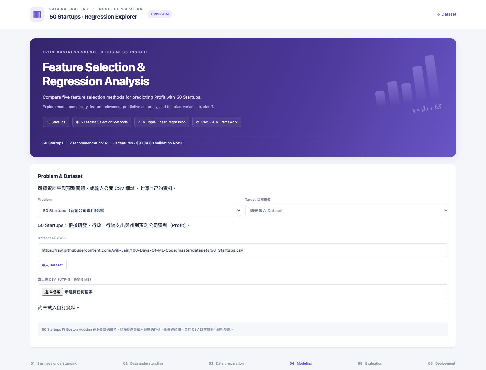
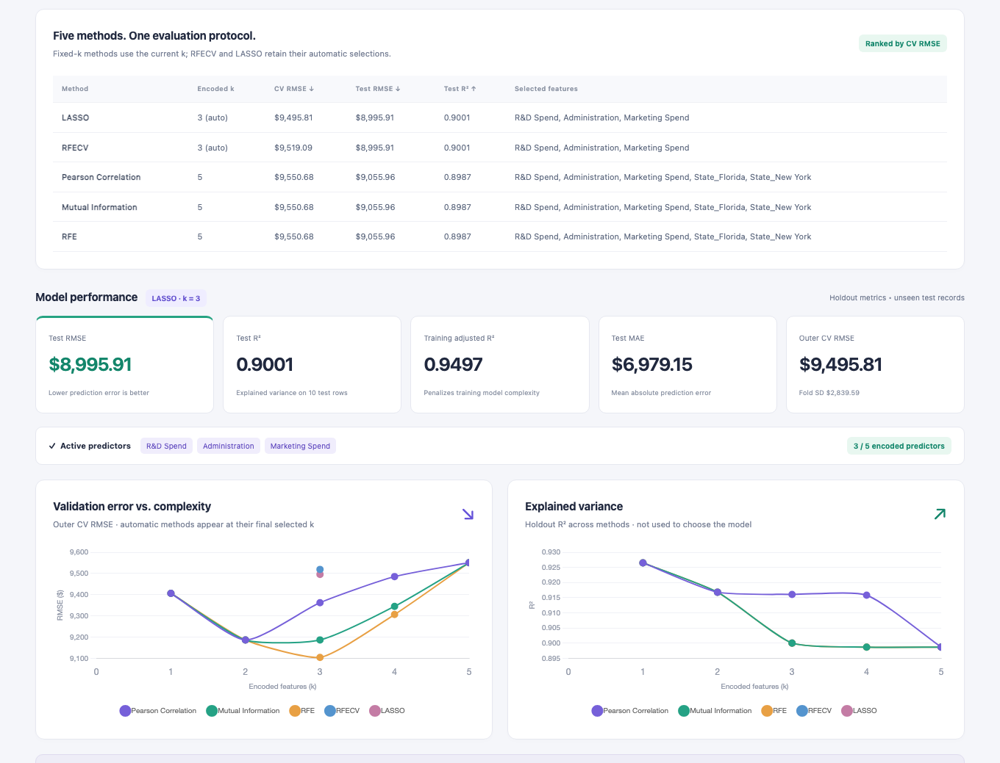
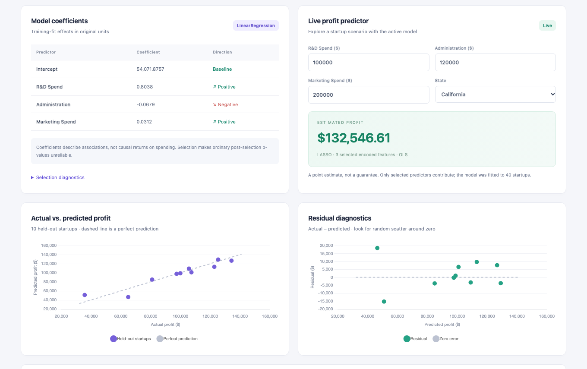
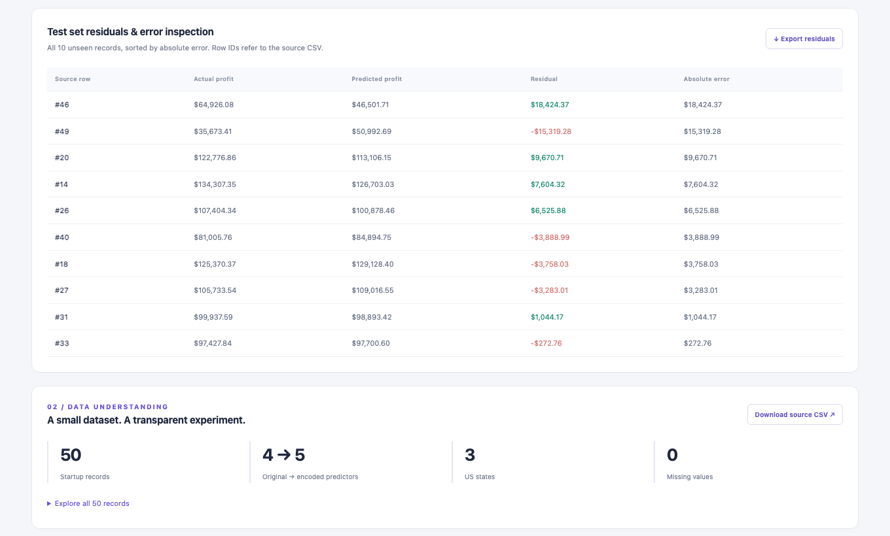

# 50 Startups & Boston Housing Regression Explorer

以 **CRISP-DM** 為架構的互動式多元線性回歸儀表板，支援 50 Startups 與 Boston Housing 資料集，比較五種特徵選擇方法，探索新創公司獲利與房價預測。

## 線上 Demo

**👉 [開啟互動展示網站](https://wujin57.github.io/AIOT-DIC2/)**

https://wujin57.github.io/AIOT-DIC2/

免安裝，直接透過瀏覽器操作。新版支援 **50 Startups 獲利預測**、**Boston Housing 房價預測**，以及自訂 CSV 網址／檔案預覽。

在 **Problem** 下拉選單切換資料集，即可查看各自訓練的模型、評估圖表與即時預測。

## Demo 畫面

以下為 50 Startups 範例畫面；新版 Demo 另提供 Boston Housing 切換與房價預測。

### 1. 特徵選擇與模型設定



比較 **Pearson Correlation、Mutual Information、RFE、RFECV、LASSO** 五種方法。支援固定特徵數的演算法在 50 Startups 可選擇 k = 1–5、Boston Housing 可選擇 k = 1–13；RFECV 與 LASSO 使用自動選擇的特徵數。

### 2. 方法比較與模型評估



點選 **Compare All 5 Methods**，並排查看各方法的選取特徵、CV RMSE、Test RMSE 與 Test R²。透過驗證誤差與解釋變異曲線，觀察模型複雜度和預測表現的關係。

### 3. 模型係數與即時獲利預測



查看迴歸係數，輸入研發支出、行政支出、行銷支出及州別，即時計算預估獲利。搭配實際值與預測值散佈圖、殘差診斷圖，檢視模型誤差。

### 4. 殘差檢視與資料集探索



查看 10 筆測試資料的實際獲利、預測獲利、殘差及絕對誤差，並下載殘差 CSV、原始資料與模型 JSON。資料集包含 50 筆記錄，4 個原始預測變數經編碼後形成 5 個模型欄位。

## 快速體驗

1. 開啟 [Demo 網站](https://wujin57.github.io/AIOT-DIC2/)。
2. 在 **Problem** 選擇 **50 Startups** 或 **Boston Housing**，再選擇特徵選擇演算法與特徵數。
3. 點選 **Compare All 5 Methods** 比較結果。
4. 在 **Live Profit predictor** 或 **Live medv predictor** 輸入特徵，觀察獲利或房價預測（Boston 單位為千美元）。
5. 查看下方的預測圖、殘差表與資料集。

## 專案資訊

- **資料集：** [50_Startups.csv](https://raw.githubusercontent.com/Avik-Jain/100-Days-Of-ML-Code/master/datasets/50_Startups.csv)
- **模型：** scikit-learn `LinearRegression`，特徵選擇後重新擬合 OLS。
- **評估：** 80/20 訓練測試切分、`random_state=42`、訓練資料上的 5-fold cross-validation。
- **技術：** Python、pandas、NumPy、scikit-learn、HTML、CSS、JavaScript、Chart.js。
- **部署：** GitHub Pages，推送到 `main` 後由官方 Actions 自動部署。

模型係數代表關聯而非因果；預估獲利是模型估計，並非保證。

## 自訂 Problem 與 Dataset

首頁的 **Problem & Dataset** 下拉選單提供 **50 Startups（新創公司獲利預測）**、**Boston Housing（房價預測）** 與 **自訂 Dataset**。
切換預設問題會自動填入 CSV 網址、載入資料預覽，並選取對應的目標欄位（Profit 或 medv）。
貼上公開 CSV 網址並按「載入 Dataset」，或上傳本機 UTF-8 CSV，即可查看資料列數、欄位數與前 20 列，並選擇 Target 目標欄位。
網址來源須允許跨來源存取（CORS）；若無法下載，可改用檔案上傳。支援最多 5 MB、10,000 列、2–100 欄。

50 Startups 與 Boston Housing 已各自訓練模型。切換預設問題時，評估、特徵選擇、係數、圖表、預測表單與下載內容都會切換至對應資料集。自訂 CSV 目前僅提供預覽，會隱藏預設模型結果。

Boston 使用 13 個特徵、目標 medv（千美元），以固定 seed=42 切分 404 筆訓練與 102 筆測試資料。五種特徵選擇方法共產生 41 組模型，採訓練集五折交叉驗證推薦模型。網站載入由 Python 預先訓練的模型，不在瀏覽器內重新擬合。

重新訓練 Boston：

```sh
.venv/bin/python scripts/train_models.py --problem boston
```

可加上 `--download` 更新 CSV；不加時會使用已保存的資料。

本機啟動：

```sh
python3 -m http.server 8000 --directory dashboard
```

開啟 http://localhost:8000 即可操作。
